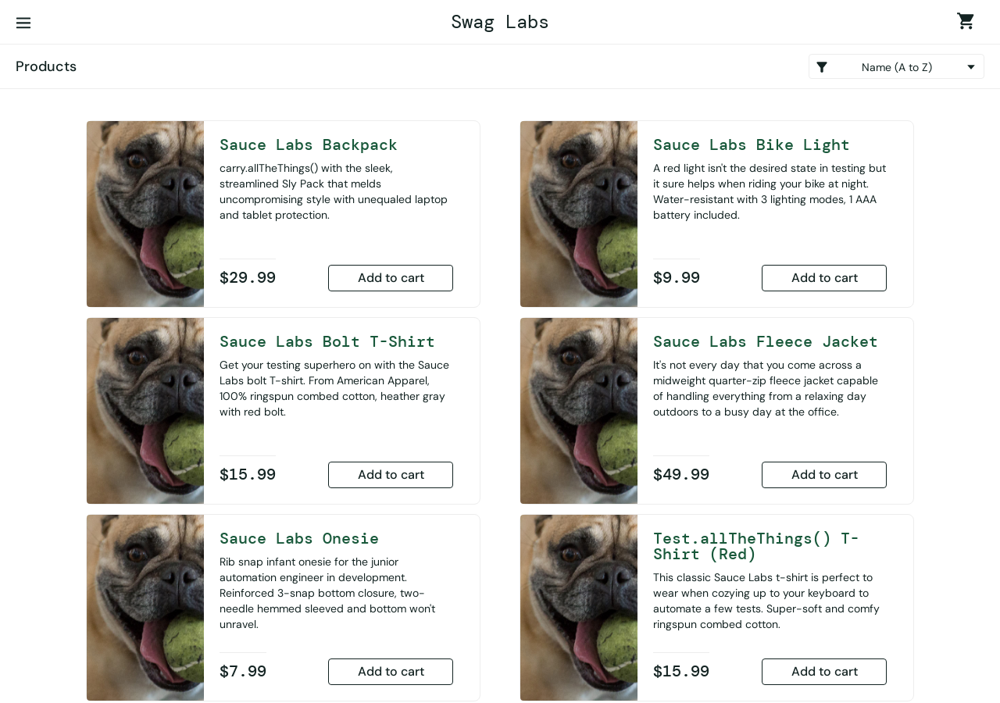
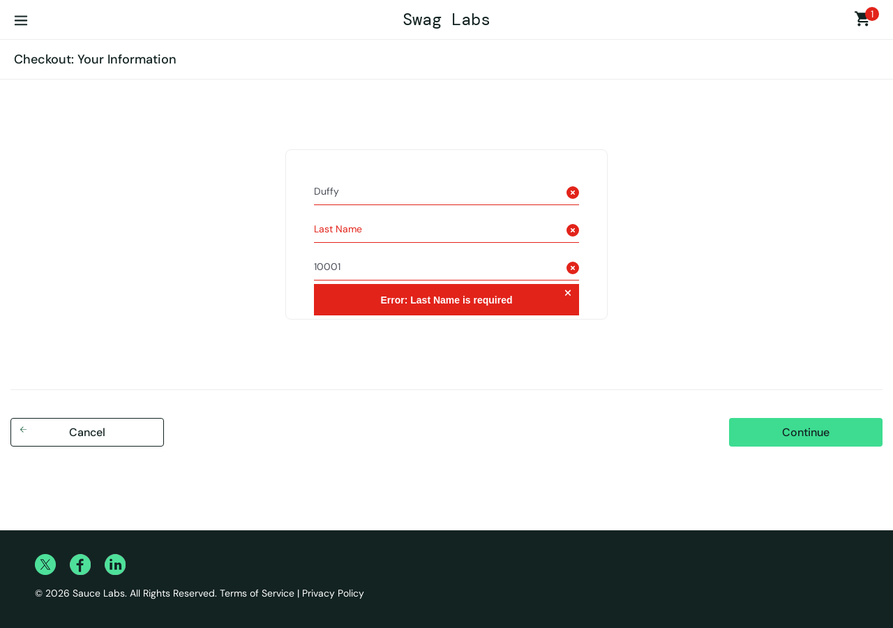

# Bug Reports: Swag Labs (saucedemo.com)

These defects were found during exploratory testing with the `problem_user` account. Each one was reproduced more than once and has an automated regression test marked `test.fail()`. When a bug is fixed, that test starts reporting "expected to fail but passed", which tells the team the ticket can be closed.

**Environment (all bugs):** https://www.saucedemo.com · Chromium (Playwright "Desktop Chrome" profile) · Ubuntu Linux · tested October 2026
**Account:** `problem_user` with the public demo password
**Control:** none of these happen with `standard_user`.

| ID | Summary | Severity | Priority | Status |
|---|---|---|---|---|
| [BUG-001](#bug-001) | All products show the same placeholder (dog) image | Medium | Medium | Open |
| [BUG-002](#bug-002) | Product sort dropdown doesn't reorder products | Medium | Medium | Open |
| [BUG-003](#bug-003) | "Add to cart" does nothing for 3 of 6 products | High | High | Open |
| [BUG-004](#bug-004) | "Remove" on the inventory page does nothing | High | High | Open |
| [BUG-005](#bug-005) | Typing a last name overwrites the first name, so checkout can't be completed | Critical | High | Open |

---

## BUG-001

**Title:** Inventory page shows the same placeholder image for every product

| Field | Value |
|---|---|
| Severity | Medium: wrong product information shown, but the purchase still works |
| Priority | Medium |
| Component | Inventory page |
| Regression test | `tests/login.spec.ts` · TC-008 |

**Steps to reproduce**
1. Go to https://www.saucedemo.com
2. Log in as `problem_user`
3. Look at the product images on the inventory page

**Expected result:** each product shows its own photo (backpack, bike light, t-shirt, and so on).

**Actual result:** all 6 products show the same photo of a dog. Every image uses the same file (`/assets/sl-404-*.jpg`, a 404 placeholder image) instead of the product's own image.

**Evidence**

---

## BUG-002

**Title:** Choosing a sort option doesn't change the product order

| Field | Value |
|---|---|
| Severity | Medium: customers can't sort products by price or name; browsing still works |
| Priority | Medium |
| Component | Inventory page, sort dropdown |
| Regression test | `tests/sorting.spec.ts` · TC-028 |

**Steps to reproduce**
1. Log in as `problem_user`
2. In the sort dropdown, choose **Price (low to high)**
3. Read the prices from top to bottom
4. Repeat with **Name (Z to A)**

**Expected result:** step 3 shows $7.99, $9.99, $15.99, $15.99, $29.99, $49.99. Step 4 shows products in reverse alphabetical order.

**Actual result:** the order doesn't change. Step 3 shows $29.99, $9.99, $15.99, $49.99, $7.99, $15.99 (the default A-to-Z order). Step 4 still shows A to Z, starting with "Sauce Labs Backpack".

**Evidence:** the page after choosing "Price (low to high)" looks exactly the same as the screenshot in BUG-001. Run `npx playwright test -g "TC-028"` to reproduce it automatically.

---

## BUG-003

**Title:** "Add to cart" button doesn't respond for some products

| Field | Value |
|---|---|
| Severity | High: customers can't buy half of the catalogue |
| Priority | High |
| Component | Inventory page, Add to cart |
| Regression test | `tests/cart.spec.ts` · TC-016 |

**Steps to reproduce**
1. Log in as `problem_user`
2. Click **Add to cart** on each of the 6 products
3. Check the cart badge and open the cart

**Expected result:** badge shows **6** and the cart lists all 6 products.

**Actual result:** badge shows **3**. Clicking **Add to cart** on **Sauce Labs Bolt T-Shirt**, **Sauce Labs Fleece Jacket** and **Test.allTheThings() T-Shirt (Red)** does nothing: the button doesn't change and nothing is added. Only Backpack, Bike Light and Onesie end up in the cart.

---

## BUG-004

**Title:** "Remove" button on the inventory page doesn't remove the item

| Field | Value |
|---|---|
| Severity | High: customers can't change their cart from the product list |
| Priority | High |
| Component | Inventory page, Remove |
| Regression test | `tests/cart.spec.ts` · TC-017 |

**Steps to reproduce**
1. Log in as `problem_user`
2. Click **Add to cart** on Sauce Labs Backpack (badge shows 1)
3. Click **Remove** on Sauce Labs Backpack

**Expected result:** badge disappears and the button changes back to **Add to cart**.

**Actual result:** nothing happens. The badge still shows 1 and the button still says **Remove**. The same happens for every product that was added.

---

## BUG-005

**Title:** Typing in the Last Name field changes the First Name field; checkout can't be completed

| Field | Value |
|---|---|
| Severity | Critical: no order can be completed (blocks revenue) |
| Priority | High |
| Component | Checkout step one, "Your Information" form |
| Regression test | `tests/checkout.spec.ts` · TC-023 |

**Steps to reproduce**
1. Log in as `problem_user`
2. Add Sauce Labs Backpack to the cart, open the cart, click **Checkout**
3. Type `Adam` in **First Name**
4. Type `Duffy` in **Last Name**
5. Type `10001` in **Postal Code** and click **Continue**

**Expected result:** First Name = "Adam", Last Name = "Duffy". The user moves on to **Checkout: Overview**.

**Actual result:** typing in **Last Name** replaces the **First Name** value (First Name now shows "Duffy") and Last Name stays empty. Clicking **Continue** shows "Error: Last Name is required", and there's no way to get past this step.

**Evidence**

